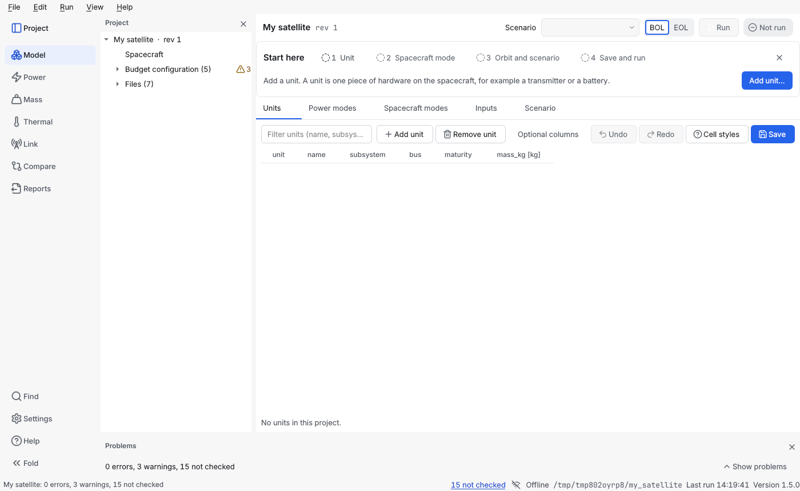

# Create a project

A project is a folder of plain-text YAML files that describe one spacecraft; this page shows how to start one and what the folder holds.

**Contents:** [With the wizard](#how-do-i-start-a-project-with-the-wizard) · [A blank project](#how-do-i-start-a-blank-project) · [From an example](#how-do-i-start-a-project-from-an-example-on-the-command-line) · [The folder](#what-is-in-a-project-folder) · [Revisions](#how-do-i-keep-revisions)

## How do I start a project with the wizard?

1. Start the window: `system-budget-studio`.
2. Choose **File → New project (guided)** (Ctrl+N). Five short pages follow:
   1. **Project**: a name and the parent folder. The project goes into a new folder named after the project; an existing folder is never touched.
   2. **Spacecraft**: a sample to start from: a 250 kg minisatellite with complete example inputs, a 150 kg microsatellite with two links, a 250 kg minisatellite with placeholder inputs, or a [blank project](#how-do-i-start-a-blank-project).
   3. **Orbit**: altitude (160 to 2000 km), inclination and RAAN of a near-circular orbit.
   4. **Scenario**: how long to simulate (up to 180 days) and when it starts (UTC). The guided wizard builds near-circular orbits; an elliptical orbit comes from [Add scenario](scenarios.md#how-do-i-add-an-orbit-and-a-scenario-in-the-window).
   5. **Review**: **Finish** creates the project, opens it and computes the first power timeline.

With the defaults you press **Next** four times and **Finish**. The result is a *sample* project with **invented** numbers (its description says so). Replace them with your own sourced numbers; the Problems panel lists what is still open (in the focused view it is one line of counts: press **Show problems** to open the list). The default sample, the one with complete inputs, has two findings **on purpose** (a thermal margin that is too small, shown as an error as soon as it opens, and, after **Run**, a peak power above its limit); the wizard says so under the sample list, so that a finding is not taken for a fault. [Getting started](../getting-started.md#5-a-first-worked-example-find-and-fix-a-power-violation) fixes the power one.

## How do I start a blank project?

A blank project is a spacecraft you describe yourself: no sample, no invented numbers.

**In the window:** choose **File → New project (guided)**, and on the **Spacecraft** page pick **Blank project**. Two more fields appear: the name of the bus (default `main`) and its **nominal voltage in volts**, which has no default because it is your design value. The orbit and scenario pages are skipped (there is no unit to simulate yet), the **Review** page follows, and **Finish** creates the project and opens it on the **Units** page, with a **Start here** card above the work area that lists what is left to do: add a unit, add a spacecraft mode, add an orbit and a scenario, save and run. Its buttons are the same as **Edit → Add unit**, **Add spacecraft mode** and **Add scenario**; **Help → Start here** shows the card again after you hide it.



**On the command line:**

```bash
budget new my_satellite --bus-voltage-v 28
```

The folder must not exist; the project name defaults to the folder name (`--name`, `--bus-name` and `--spacecraft-name` change the names). The command writes the folder and prints what to do next; it never touches an existing folder.

What a blank project contains:

- `project.yaml` and `spacecraft.yaml` with one bus (the name and voltage you gave) and no mission phases,
- `config/`: the margin policy (three maturity classes `class_a`, `class_b` and `class_c`, which are only labels you can rename), the power configuration and a bus efficiency, all marked `source: TBD`, and empty Eb/N0, attenuation and mass-limit tables.

There are no units, spacecraft modes, orbits, scenarios or links, and no number except the voltage. `budget validate` reports **0 errors**, and a few warnings that are your to-do list: each placeholder (`CONFIG_PLACEHOLDER`) and each empty table (`CONFIG_EMPTY_TABLE`). Reports computed from it say **INCOMPLETE** until you fill them in.

Then build it up: add the units, their power modes and the spacecraft modes ([Describe the spacecraft](describe-the-spacecraft.md)), then an orbit and a scenario, and replace each placeholder with a sourced number ([placeholders and sources](placeholders-and-sources.md)). Add the first unit with **Add unit** in **Model → Units**: it asks for the mass and the first power mode ([how](describe-the-spacecraft.md#how-do-i-add-a-unit)). Then add a spacecraft mode with **Add spacecraft mode** in **Model → Spacecraft modes** ([how](describe-the-spacecraft.md#how-do-i-add-a-spacecraft-mode)), and an orbit and a scenario with **Add scenario** in **Model → Scenario** ([how](scenarios.md#how-do-i-add-an-orbit-and-a-scenario-in-the-window)). After that, **Run** gives the first timeline of eclipses and, once the power inputs are real numbers, of power. Ground stations, targets, links and expendables are still files; the manual pages say how.

## How do I start a project from an example on the command line?

Copy an example and edit it (or start [blank](#how-do-i-start-a-blank-project)):

```bash
budget export-examples demo
cp -r demo/microsat_250kg my_satellite          # Windows: Copy-Item -Recurse demo\microsat_250kg my_satellite
```

Then open `my_satellite/project.yaml` and change `name`, `revision` and `description`, and replace the example units with yours ([Describe the spacecraft](describe-the-spacecraft.md)). Check as you go:

```bash
budget validate my_satellite
```

## What is in a project folder?

```text
project.yaml              name, revision, description
spacecraft.yaml           buses, mission phases, body frame
units/<id>.yaml           one file per unit: mass, bus, maturity, power modes, limits
modes/<id>.yaml           spacecraft modes: which power mode each unit is in
orbits/  ground_stations/  targets/  scenarios/
links/<id>.yaml           one file per radio link
expendables/<id>.yaml     consumables with a mass for every mission phase
config/                   margin policy, power system, thermal model, Eb/N0 and attenuation tables
results/                  written by the tool; not part of the project
```

Every file begins with `schema_version` and `kind`. Files are meant to be edited with any text editor and compared with ordinary tools: put the folder in git and you have a full history. Units, modes, links and scenarios are separate files so several people can work on different ones at the same time. The complete field list is the [project file format](../FILE_FORMAT.md); `budget export-schemas schemas` writes a JSON Schema for every kind, which many editors can use for completion.

The **id** of a unit, mode, site, scenario or link is its file name without `.yaml`; use letters, digits, `_` and `-` (other names load with a warning, see the [file format](../FILE_FORMAT.md#ids-text-and-numbers-decisions-d-120-to-d-124)). Only names ending in exactly `.yaml` are read: a file such as `camera.yml` or a sub-folder inside `units/` is skipped, and the tool says so (`FILE_IGNORED`).

Files written by an earlier version of the tool are upgraded in memory when loaded (you see the information message `FILE_MIGRATED`) and are written back in the new format only when you save them. A file from a *newer* version is refused with a clear message.

## How do I keep revisions?

`project.yaml` has a `revision` field. Increase it whenever you change numbers behind a report: it is printed on every output and used to label the sides of a [comparison](compare.md). Keep each revision as a git tag or a copy of the folder.

Next: [Describe the spacecraft](describe-the-spacecraft.md).
