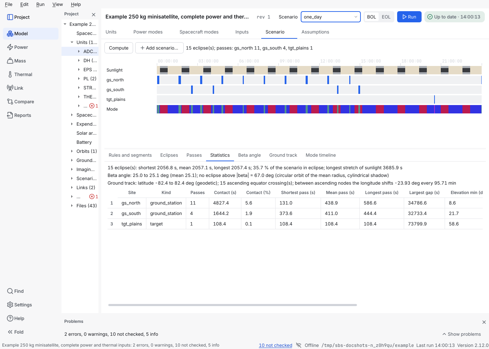
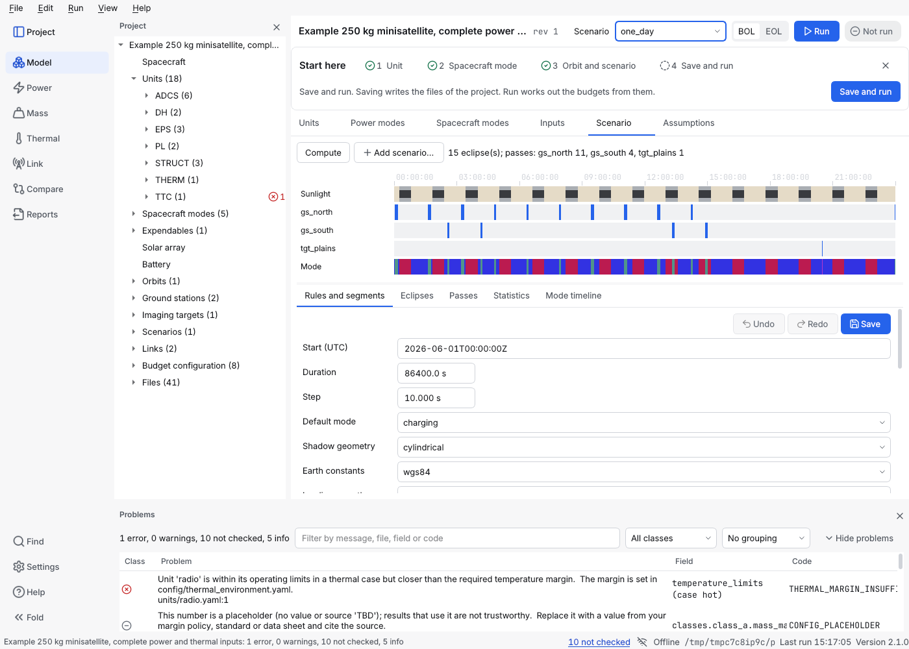

# Scenarios

This page shows how to place the spacecraft in an orbit for a span of time and decide which spacecraft mode is active when; the time-domain power budget and the link passes need a scenario.

**Contents:** [Orbit](#how-do-i-define-an-orbit) · [Orbit design](#how-do-i-design-the-orbit-local-time-sun-synchronous-repeat-ground-track) · [Ground stations and targets](#how-do-i-add-a-ground-station-or-an-imaging-target) · [The scenario file](#how-do-i-write-a-scenario) · [Mode rules](#how-do-i-switch-modes-automatically) · [Compute and look](#how-do-i-see-eclipses-passes-and-the-timeline) · [SpaceMissionStudio](#how-do-i-use-orbit-data-from-spacemissionstudio)

## How do I add an orbit and a scenario in the window?

Press **Ctrl+Shift+O** (**Edit → Add scenario**, or *Add scenario* in Ctrl+K), or open **Model → Scenario** and press **Add orbit and scenario…** (the page offers it when the project has no scenario). The project needs a spacecraft mode first. A form asks for the name, the id (suggested from the name; it becomes the file names `scenarios/<id>.yaml` and `orbits/<id>.yaml`), the **altitude**, **inclination** and **RAAN** of the orbit, the **start** (UTC, for example `2026-06-01T00:00:00Z`), the **length** in days (up to 180) and the **spacecraft mode** that is active the whole time. None of the numbers has a default, and the form does not accept an empty one. The orbit is near-circular (an eccentricity of 0.001; the scenario's description says so) unless you give an **apogee altitude**: then the **altitude** is the perigee altitude (160 to 2000 km) and the apogee altitude may be up to 40,000 km, and you also give the **argument of perigee** (0 up to, not including, 360 degrees); the orbit is elliptical, from the two altitudes, and the scenario starts at perigee. The time step is 10 s, or coarser for a long scenario so that a run has at most 8,640 steps, but never coarser than 600 s (a coarser step cannot find the orbits). A run of 180 days took under a minute on the machine it was measured on. There are no ground stations and no rules yet, so the first run has eclipses but no passes: add them below (**Ctrl+Shift+G** adds a ground station; the rules are sentences in the editor on this page). Both files are added in one undo step and **Save** (Ctrl+S) writes them; then press **Run**.

## How do I define an orbit?

`orbits/<id>.yaml` takes either a two-line element set (a [**TLE**](../glossary.md#tle): two 69-character lines, checksums verified) or mean orbital elements:

```yaml
schema_version: 1
kind: orbit
name: Example sun-synchronous-like orbit, about 550 km
elements:
  epoch_utc: '2026-06-01T00:00:00Z'
  semi_major_axis_m: 6928137.0
  eccentricity_ratio: 0.001
  inclination_deg: 97.6
  raan_deg: 100.0
  arg_perigee_deg: 90.0
  mean_anomaly_deg: 0.0
```

Instead of a TLE or elements an orbit may be a **state vector**, a position and velocity at an epoch:

```yaml
schema_version: 3
kind: orbit
name: Orbit from a state vector
state:
  epoch_utc: '2026-06-01T00:00:00Z'
  frame: j2000                      # j2000 or teme; required, there is no default
  position_m: [6871000.0, 1200000.0, 800000.0]
  velocity_m_s: [-900.0, 7100.0, 1500.0]
```

The scenario converts it to the mean elements whose SGP4 state at the epoch is this state, so the orbit starts exactly where you put it; after the epoch it is SGP4's orbit. `budget orbit from-state` prints those elements and how far the osculating orbit of the state is from them (for a 600 km orbit the semi-major axis differs by about 12 km: elements copied from an osculating source and typed as `elements:` would start 10 km off, a state vector does not). **J2000** is the frame most tools export; **TEME** is what SGP4 works in; the two differ by up to a degree. A state that is not a bound orbit, or whose perigee is below the surface, is refused ([deviation DV-E7](../DEVIATIONS.md)). In the window the orbit helper's fourth request, *Mean elements of a state vector*, writes the six elements to an elements orbit.

Positions come from the [SGP4](../glossary.md#sgp4) propagator (Earth only; elements are used as SGP4 mean elements, without drag: see [deviation DV-E2](../DEVIATIONS.md)). The guided wizard writes a near-circular orbit for you from altitude, inclination and [RAAN](../glossary.md#raan).

## How do I give the orbit by its local time?

Instead of `raan_deg` the elements may give `ltan_h`, the **mean local solar time of the ascending node** in hours (10.5 is 10:30), and the tool derives the RAAN at the epoch. Exactly one of the two is given:

```yaml
elements:
  epoch_utc: "2026-06-01T00:00:00Z"
  semi_major_axis_m: 7028137.0
  eccentricity_ratio: 0.0011
  inclination_deg: 97.9
  ltan_h: 10.5              # instead of raan_deg
  arg_perigee_deg: 90.0
  mean_anomaly_deg: 0.0
```

The local time is mean solar time without the equation of time ([deviation DV-E6](../DEVIATIONS.md)). The RAAN follows the epoch: the same `ltan_h` at another epoch is another RAAN, because the Sun has moved. The scenario notes say which RAAN was derived.

## How do I design the orbit (local time, sun-synchronous, repeat ground track)?

An orbit file takes inclination and right ascension (RAAN). A mission is usually described by other numbers: the **local time of the ascending node** (LTAN, for example 10:30 or 22:30), a **sun-synchronous** orbit at some altitude, or a **repeat ground track**. `budget orbit` works out the elements from those; it reads no project and changes none. All times are *mean* local solar time (the equation of time is not applied), and the Earth constants are those of the scenario's Earth model (`--earth-model`, WGS-84 by default).

```bash
# a sun-synchronous orbit at 600 km with the node at 10:30 mean local time on 2026-06-01
budget orbit sso --altitude-km 600 --ltan 10:30 --epoch 2026-06-01T00:00:00Z

# the right ascension of a node at a local time (and the other way: --raan DEG)
budget orbit ltan --epoch 2026-06-01T00:00:00Z --ltan 10:30

# the sun-synchronous orbit with 15 revolutions in one day, and every repeat cycle between 500 and 800 km
budget orbit repeat --revolutions 15 --days 1 --sso
budget orbit repeats --altitude-min-km 500 --altitude-max-km 800 --max-days 5 --sso
```

In the window, **Edit → Orbit helper…** (**Ctrl+Shift+H**) does the same in a dialog: choose *Sun-synchronous orbit*, *Repeat ground track* or *Local time of the node of a given orbit*, type the epoch (UTC) and the numbers, and the dialog shows the inclination, the RAAN, the nodal period and the local time of both nodes, or says in words why there is no such orbit. **Write to orbit** sets the elements of the orbit you choose (epoch, semi-major axis, eccentricity, inclination and, when you gave a local time, the RAAN) as one undo step and records how they were derived in the orbit file's `provenance:`; the argument of perigee and the mean anomaly stay as they are, and an orbit given as a TLE is not offered. The *Add orbit and scenario* form has an **Orbit helper…** button that fills the altitude, inclination and RAAN (and the start, when empty) instead. From the command line, put the inclination and the RAAN it prints into the orbit file (`elements:`, with the epoch you gave). A sun-synchronous orbit is retrograde (inclination above 90°) and only exists below about 5,974 km; a request with no solution says so. The tool treats the elements as mean elements (DEVIATIONS DV-E2), so the node of the orbit it then propagates keeps its local time to about 11 seconds in 30 days, and sits about two minutes of local time from the designed one; the equations, the checks and the limits are in [orbit design](../models/orbit-design.md).

## How do I add a ground station or an imaging target?

**In the window:** press **Ctrl+Shift+G** (**Edit → Add ground station**) or **Ctrl+Shift+T** (**Edit → Add imaging target**), or find them in Ctrl+K. A form asks for the name, the id (suggested from the name; it becomes the file name `ground_stations/<id>.yaml` or `targets/<id>.yaml`), the **latitude** and **longitude** in degrees, the **altitude** in metres and the **minimum elevation** in degrees. None of the numbers has a default, and the form does not accept an empty one or text that is not a number. An id that a ground station or a target already has is refused (a scenario names either by id). The file is added in one undo step and **Save** (Ctrl+S) writes it. The scenario does not use it until you tick it under **Sites** (below) or list it in `sites`. To remove one, use **Ctrl+Shift+R** (**Edit → Remove from project**); it is refused while a scenario lists the site or, for a ground station, a link names it. To remove one, press **Ctrl+Shift+R** (**Edit → Remove from project**): it is refused, with the reason, while a scenario lists the station or target (under **Sites** or in a rule) or, for a ground station, while a link names it as its peer. Change the scenario or remove the link first.

**By hand**, the file is:

```yaml
# ground_stations/gs_north.yaml     (an imaging target is the same, in targets/)
schema_version: 1
kind: ground_station
name: Example station north
latitude_deg: 67.0
longitude_deg: 20.0
altitude_m: 100.0
min_elevation_deg: 5.0
```

A [**pass**](../glossary.md#pass) is a time during which the satellite is above `min_elevation_deg`. Ids are unique across stations and targets.

## How do I write a scenario?

`scenarios/<id>.yaml`:

```yaml
schema_version: 2
kind: scenario
name: One day
environment_source: elements      # or spacemissionstudio
orbit: leo
start_utc: '2026-06-01T00:00:00Z' # UTC only
duration_s: 86400.0
step_s: 10.0                      # the time grid of the results
shadow_model: cylindrical         # or conical
earth_model: wgs84                # or wgs72 (optional, see below)
irradiance_model: constant        # or seasonal (optional, see below)
sites: [gs_north, tgt_plains]     # stations and targets to compute passes for
mission_phase: eol                # selects the allowed depth of discharge
default_mode: charging
rules: []
segments: []
```

A scenario may have up to 1,000,000 steps (a week at 1 s is 604,801), counted at the smaller of `step_s` and 20 s. The start time must lie between the years 1950 and 2100; a semi-major axis between 6,400 km and 100,000 km; a TLE more than 30 days from the start gives a warning. [`shadow_model`](../glossary.md#shadow-model) is the Earth shadow: `cylindrical` (sharp edge) or `conical` (umbra and penumbra).

## How do I choose the Earth model and the irradiance model?

The Earth model: `earth_model` is `wgs84` (the default, and what a scenario without the line uses) or `wgs72`. It sets the gravity constants an orbit given as elements is propagated with and the radius of the Earth sphere of the shadow; the difference is 2 m in the radius and about 8e-7 of mu, small beside the other errors of the model, and it matters when you compare with a tool that uses the other set. A TLE is always propagated on WGS-72 (the set SGP4 is defined on), so the line does nothing for it and the tool says so (`MODEL_CHOICE_IGNORED`); ground sites stay WGS-84 geodetic coordinates. A project that uses the line lists `model_choices` under `requires:` in `project.yaml`, so that an older version refuses it instead of ignoring it. Every report says which model it used (the provenance row *Earth model*), and `budget choices environment.earth_model` explains it.

The irradiance model: `irradiance_model` is `constant` (the default: `solar_irradiance_wm2` of the power system file as it is, whatever the date) or `seasonal`. With `seasonal` that number is read as the value **at 1 AU** (the usual way a solar constant is given) and every step of the array output is scaled by (1 AU / R)², with R the Earth-Sun distance of the Sun model: about 3.4 % more in early January, 3.3 % less in early July (a ratio of 1.069 between the two). It needs no new number, and the result then depends on the date of the scenario: the report shows the mean factor over the scenario in its run parameters (*Irradiance model*), and *Explain* shows the step. Albedo and Earth infrared are still not modelled (DEVIATIONS DV-P5). Use `seasonal` when you compare a design across the year or against a tool that varies the irradiance; the two models differ by at most 3.4 % of the array output.

## How do I switch modes automatically?

`default_mode` is active unless a **rule** or a **segment** says otherwise. Rules are applied in order, later rules win, then the hand-placed segments:

```yaml
rules:
  - {kind: in_eclipse, mode: nominal}
  - {kind: during_pass, site: tgt_plains, mode: imaging, lead_s: 30}
  - {kind: during_pass, site: gs_north, mode: downlink}
  - {kind: in_sunlight, mode: charging}
segments:                         # hand-built, applied last, must not overlap
  - {start_s: 0, duration_s: 1800, mode: safe}
```

`lead_s` and `lag_s` start the mode earlier or end it later around a pass. In the window **Model → Scenario** shows the timeline and lets you edit rules and segments ([below](#how-do-i-edit-the-rules-in-the-window)); invalid edits are explained and nothing is written until you save.

## Pointing and manoeuvres in a scenario

Pointing changes and burns cost power, and the power budget should see them. A scenario can say which **pointing mode** holds when (separately from the spacecraft modes) and **place burns** of the propulsion file:

```yaml
pointing_default: nadir            # a pointing mode of config/pointing.yaml
pointing_rules:                    # like the mode rules; `mode` is a pointing mode
  - {kind: during_pass, site: tgt_plains, mode: target, lead_s: 30}
maneuvers:                         # burns of config/propulsion.yaml, by name
  - {name: Orbit trim, start_s: 3600}
```

- The **holding power** of the active pointing mode (`hold_power_w`) is added to the demand. A mode with no holding power is not modelled and adds nothing; a placeholder makes the load unknown (n/a), never zero.
- Where the pointing mode changes, the **slew** between the two modes (from `config/pointing.yaml`) is flown: the actuators draw their slew power for the slew time, then the new mode's holding power takes over. A change with no slew defined is `POINTING_SLEW_MISSING` and costs nothing; a slew longer than the mode it leads to is cut (`POINTING_SLEW_TOO_LONG`).
- A placed **manoeuvre** lasts its burn time (the propellant of the line at the system's constant thrust) from `start_s`. An electric system draws its thrusting power meanwhile; a chemical one draws none. A manoeuvre of the propulsion file that names a `mode` switches the scenario to that spacecraft mode for the burn (the manoeuvre mode). A burn past the end of the scenario is cut (`MANEUVER_CUT`). A line with several burns (`count`) is placed as one, lasting all its burns.
- The load is shown on its own line, *Pointing and propulsion load*, in the power timeline, never mixed into the demand of the spacecraft modes. **No margin is applied to it**: put the margin in the inputs.

In the window, *Model → Scenario* has a **Pointing** section (the default pointing mode and the pointing rules) and a **Manoeuvres** section (the burns), each change one undo step. The examples do not use these fields; add them to a copy to try them.

## How do I see eclipses, passes and the timeline?

```bash
budget scenario my_satellite --out out
```

```text
Scenario one_day (elements): 15 eclipse(s); passes: gs_north 11, gs_south 4, tgt_plains 1; 62 timeline segment(s).
```

It writes `<id>_environment.json`, `<id>_eclipses.csv`, `<id>_passes.csv`, `<id>_timeline.csv`, `<id>_beta.csv` (the beta angle over the scenario), `<id>_groundtrack.csv` (the sub-satellite point) and a provenance file. Passes and eclipses are detected on a fixed 20 s grid (a pass of a few seconds between two samples is found from the elevation maximum, and an eclipse of a few seconds from the maximum of how far inside the shadow the satellite is) and their edges are refined to about 1 ms, so they do not depend on `step_s`. The window's **Scenario** tab shows the same tables after **Compute**; to write the same files from the window use **File → Export scenario results**.

### Statistics of the eclipses and the passes

After **Compute**, the **Statistics** tab gives a quick insight without a spreadsheet. Above the table: the number of eclipses, the shortest, the mean and the longest, the share of the scenario in eclipse and the longest stretch of sunlight. The table has a row for every ground station and imaging target: the number of passes, the time in contact (seconds and percent of the scenario), the shortest, mean and longest pass, the **largest gap** (the longest time without a pass, the start and the end of the scenario included) and the lowest, mean and highest peak elevation. A pass cut by the start or the end of the scenario counts with its clipped length, and an imported pass without a peak elevation is left out of the elevation figures (`n/a`). 

Under the eclipse line, the **beta angle** (the angle between the Sun and the orbit plane) is given as its minimum, mean and maximum over the scenario, with the **critical beta angle**: above it a circular orbit of the mean radius has no eclipse at all (cylindrical shadow). The **Beta angle** tab plots it against time with the two critical lines, and `<id>_beta.csv` has the series (one row every ten minutes, or every step if that is longer). The beta angle comes from the angular momentum of the propagated orbit and the Sun model, so it is also given for a TLE; for an imported orbit it is taken from the imported positions. See [orbit design](../models/orbit-design.md#beta-angle).

The **Ground track** tab draws the sub-satellite point (geodetic latitude and longitude on the WGS-84 ellipsoid) on a 30-degree graticule with the stations (diamonds) and targets (squares) marked; the start is a filled circle and the end an open one, and the line is cut where it crosses the date line. The tool ships no coastline data, so there is no map of the continents. The Statistics tab adds the latitude range, the number of ascending equator crossings and how far the longitude shifts between two of them (about -24 degrees a revolution for a low orbit: the Earth turns under the orbit), and `<id>_groundtrack.csv` has the series (`time_s`, `utc`, `latitude_deg`, `longitude_deg`, `altitude_m`; one row a minute, or every step if that is longer). The longitude is east positive from -180 to 180 degrees; the Earth is rotated by the sidereal angle without polar motion, as for the station geometry (deviation DV-E1), so the point is good to about half a kilometre (the limit of DV-E1), not to survey accuracy. It is read from the computed positions and changes no result.

The **Passes** tab has a **Passes of** drop-down to show the passes of one station or target, or of all. `<id>_environment.json` carries the same figures under `statistics`. They are read from the computed eclipses and passes, so they change no result.

## How do I use orbit data from SpaceMissionStudio?

Set `environment_source: spacemissionstudio` and `import_dir:` (a folder inside the project) in the scenario. The folder holds CSV files with the orbit, eclipse intervals and passes. The format is an **interim** one, because no real export was available yet: [Environment inputs and the interim format](../ENVIRONMENT_FORMAT.md). Errors name the file and line and never echo content (`ENV_INPUT_INVALID`).


## How do I edit the rules in the window?

In **Model → Scenario**, the lower part shows the rules as sentences you can change in place:



- A rule reads *Downlink during every pass over gs_north*, and for a pass rule *Start it 30 s before the pass and keep it 0 s after it*. Its parts are the controls: the spacecraft mode, **during every pass over** / **throughout every eclipse** / **throughout every sunlit period**, the site, and the lead and lag (pass rules only). *Throughout every eclipse* keeps the mode for the whole eclipse, from entry to exit; to limit a mode to part of an eclipse use a manual segment, or a pass rule. Hover over the mode and the *when* drop-down for the same hints. Changing the kind keeps the rule valid (a pass rule gets a site; the other kinds lose the site, lead and lag).
- The order matters: **a later rule wins** over an earlier one, so every row has an **up** and a **down** arrow (hover for the tooltip). **Add rule** adds a pass rule with the default mode and the first listed site; the **bin** removes one.
- **Manual segments** read *Imaging from T+100 s for 300 s*; they are applied last. Shift+drag on the timeline adds one.
- **Start, duration and step**: the three fields at the top of the editor hold the start (UTC, for example `2026-06-01T00:00:00Z`), the duration and the step of the scenario, in seconds (86400 s is one day). A value is written when you leave the field, as one undo step. A value the model refuses (a start that is not a time, a step longer than the duration, so many steps that the run would be too large) stays as typed and the line under the editor says why; nothing is saved until it is valid. The step sets the resolution of the power timeline only: eclipses and passes are found on a finer grid whatever the step.
- **Model choices**: three drop-downs above the sites, *Shadow geometry*, *Earth constants* and *Irradiance on the array*, hold the choices described above. Hover a value for its source. A choice at its default is left out of the file; choosing another model for the Earth constants or the irradiance also lists `model_choices` under `requires:` of `project.yaml`, in the same step, so that an older version refuses the project. *Undo* takes both back. [The full list of choices](../models/choices.md).
- **Sites**: tick the sites (ground stations and imaging targets) the scenario uses. A rule must name a ticked site, otherwise the line under the editor says so.
- Every change is one step of **Edit → Undo** (Ctrl+Z); the buttons at the top of the editor (Undo, Redo, Save) are the ones of the grids. **Save** (or Ctrl+S) writes the scenario and any other changed file in place, with its comments. Nothing is saved while the model finds a problem (for example two overlapping segments): the line under the editor says what, and you can correct it or undo. Choosing another scenario keeps your unsaved edits of the first.

Next: [Reports and exports](reports-and-exports.md).
