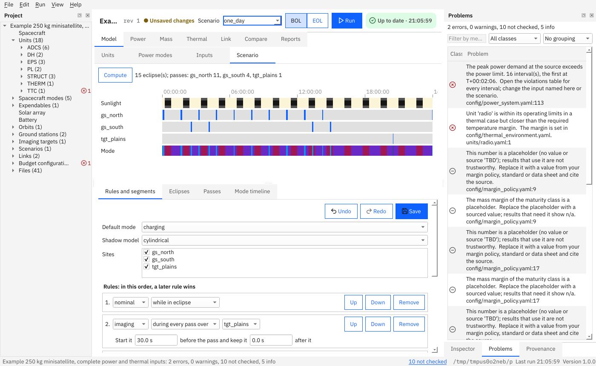

# Scenarios

This page shows how to place the spacecraft in an orbit for a span of time and decide which spacecraft mode is active when; the time-domain power budget and the link passes need a scenario.

**Contents:** [Orbit](#how-do-i-define-an-orbit) · [Ground stations and targets](#how-do-i-add-a-ground-station-or-an-imaging-target) · [The scenario file](#how-do-i-write-a-scenario) · [Mode rules](#how-do-i-switch-modes-automatically) · [Compute and look](#how-do-i-see-eclipses-passes-and-the-timeline) · [SpaceMissionStudio](#how-do-i-use-orbit-data-from-spacemissionstudio)

## How do I define an orbit?

`orbits/<id>.yaml` takes either a two-line element set (a [**TLE**](../glossary.md#tle): two 69-character lines, checksums verified) or mean orbital elements:

```yaml
schema_version: 1
kind: orbit
name: Example sun-synchronous-like orbit, about 550 km
elements:
  epoch_utc: '2026-06-01T00:00:00Z'
  semi_major_axis_m: 6928137.0
  eccentricity_ratio: 0.001
  inclination_deg: 97.6
  raan_deg: 100.0
  arg_perigee_deg: 90.0
  mean_anomaly_deg: 0.0
```

Positions come from the [SGP4](../glossary.md#sgp4) propagator (Earth only; elements are used as SGP4 mean elements, without drag: see [deviation DV-E2](../DEVIATIONS.md)). The guided wizard writes a near-circular orbit for you from altitude, inclination and [RAAN](../glossary.md#raan).

## How do I add a ground station or an imaging target?

```yaml
# ground_stations/gs_north.yaml     (an imaging target is the same, in targets/)
schema_version: 1
kind: ground_station
name: Example station north
latitude_deg: 67.0
longitude_deg: 20.0
altitude_m: 100.0
min_elevation_deg: 5.0
```

A [**pass**](../glossary.md#pass) is a time during which the satellite is above `min_elevation_deg`. Ids are unique across stations and targets.

## How do I write a scenario?

`scenarios/<id>.yaml`:

```yaml
schema_version: 2
kind: scenario
name: One day
environment_source: elements      # or spacemissionstudio
orbit: leo
start_utc: '2026-06-01T00:00:00Z' # UTC only
duration_s: 86400.0
step_s: 10.0                      # the time grid of the results
shadow_model: cylindrical         # or conical
sites: [gs_north, tgt_plains]     # stations and targets to compute passes for
mission_phase: eol                # selects the allowed depth of discharge
default_mode: charging
rules: []
segments: []
```

A scenario may have up to 1,000,000 steps (a week at 1 s is 604,801), counted at the smaller of `step_s` and 20 s. The start time must lie between the years 1950 and 2100; a semi-major axis between 6,400 km and 100,000 km; a TLE more than 30 days from the start gives a warning. [`shadow_model`](../glossary.md#shadow-model) is the Earth shadow: `cylindrical` (sharp edge) or `conical` (umbra and penumbra).

## How do I switch modes automatically?

`default_mode` is active unless a **rule** or a **segment** says otherwise. Rules are applied in order, later rules win, then the hand-placed segments:

```yaml
rules:
  - {kind: in_eclipse, mode: nominal}
  - {kind: during_pass, site: tgt_plains, mode: imaging, lead_s: 30}
  - {kind: during_pass, site: gs_north, mode: downlink}
  - {kind: in_sunlight, mode: charging}
segments:                         # hand-built, applied last, must not overlap
  - {start_s: 0, duration_s: 1800, mode: safe}
```

`lead_s` and `lag_s` start the mode earlier or end it later around a pass. In the window the **Scenario** tab shows the timeline and lets you edit rules and segments ([below](#how-do-i-edit-the-rules-in-the-window)); invalid edits are explained and nothing is written until you save.

## How do I see eclipses, passes and the timeline?

```bash
budget scenario my_satellite --out out
```

```text
Scenario one_day (elements): 15 eclipse(s); passes: gs_north 11, tgt_plains 1; 54 timeline segment(s).
```

It writes `<id>_environment.json`, `<id>_eclipses.csv`, `<id>_passes.csv`, `<id>_timeline.csv` and a provenance file. Passes and eclipses are detected on a fixed 20 s grid (a pass of a few seconds between two samples is found from the elevation maximum, and an eclipse of a few seconds from the maximum of how far inside the shadow the satellite is) and their edges are refined to about 1 ms, so they do not depend on `step_s`. The window's **Scenario** tab shows the same tables after **Compute**; to write the same files from the window use **File → Export scenario results**.

## How do I use orbit data from SpaceMissionStudio?

Set `environment_source: spacemissionstudio` and `import_dir:` (a folder inside the project) in the scenario. The folder holds CSV files with the orbit, eclipse intervals and passes. The format is an **interim** one, because no real export was available yet: [Environment inputs and the interim format](../ENVIRONMENT_FORMAT.md). Errors name the file and line and never echo content (`ENV_INPUT_INVALID`).


## How do I edit the rules in the window?

In **Model → Scenario**, the lower part shows the rules as sentences you can change in place:



- A rule reads *Downlink during every pass over gs_north*, and for a pass rule *Start it 30 s before the pass and keep it 0 s after it*. Its parts are the controls: the mode, **during every pass over** / **while in eclipse** / **while in sunlight**, the site, and the lead and lag (pass rules only). Changing the kind keeps the rule valid (a pass rule gets a site; the other kinds lose the site, lead and lag).
- The order matters: **a later rule wins** over an earlier one, so every row has **Up** and **Down**. **Add rule** adds a pass rule with the default mode and the first listed site; **Remove** removes one.
- **Manual segments** read *Imaging from T+100 s for 300 s*; they are applied last. Shift+drag on the timeline adds one.
- **Sites**: tick the sites (ground stations and imaging targets) the scenario uses. A rule must name a ticked site, otherwise the line under the editor says so.
- Every change is one step of **Edit → Undo** (Ctrl+Z); the buttons at the top of the editor (Undo, Redo, Save) are the ones of the grids. **Save** (or Ctrl+S) writes the scenario and any other changed file in place, with its comments. Nothing is saved while the model finds a problem (for example two overlapping segments): the line under the editor says what, and you can correct it or undo. Choosing another scenario keeps your unsaved edits of the first.

Next: [Reports and exports](reports-and-exports.md).
