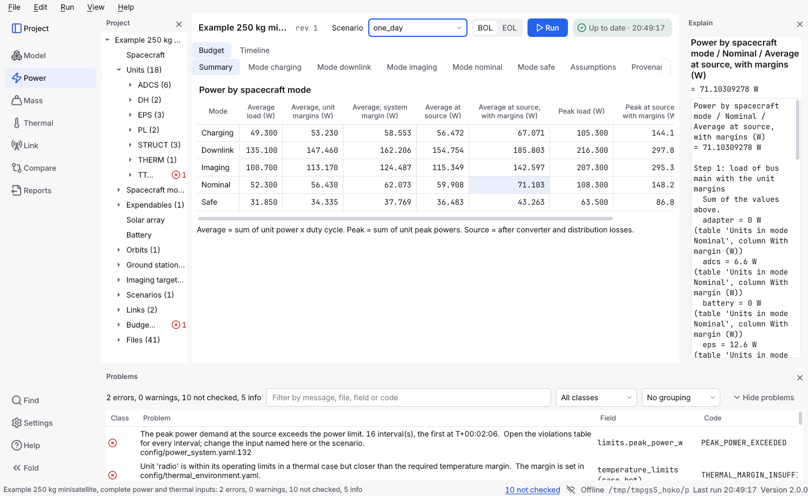

# Trace a number

Every result of the tool can be followed back to the equation that made it, to the inputs it used and to the file each input came from. This page answers: *How was this number worked out? Where did an input come from? What does the tool assume that I did not type? Which model is used, and can I choose another? Is this result from my project?*

## How do I see how a number was worked out?

In the window, select a value in a table (a power, a mass, a temperature, a link margin, a value of the power timeline or of the passes) and press **Ctrl+Shift+I**, or right-click it and choose **Explain this value**. The **Explain** panel opens on the right (**View → Explain**) with the equation, the inputs with the file and field each came from, and the steps in between. A value of the power timeline or the link passes is explained from the solver's own series; the first time, the panel says it is preparing the explanation, and the next values of the same result are immediate.



On the command line, `budget explain PROJECT` lists the tables that can be explained; name one table, a row and a column to explain one number:

```bash
budget explain demo/microsat_250kg_eps power:units:imaging --row camera --column "With margin (W)"
```

```text
Units in mode Imaging / camera / With margin (W)
= 43.2 W

Step 1: Effective power of the unit  [PWR-EFF]
  average power of camera = 60 W  (units/camera.yaml modes[1].avg_power_w)  source: "Invented example value"  [illustrative]
  duty cycle of camera = 0.6 ratio  (units/camera.yaml modes[1].duty_cycle_ratio)  source: "Invented example value"  [illustrative]
  -> effective power of camera = 36 W
…
```

Each input shows the file and the field it was read from, its recorded source, and its status when it is not `sourced`. An equation with no citation yet says `source: none yet (SOURCE_MISSING)`. How Explain works, and which tables it covers, is in [Explain: how a number was obtained](../models/explain.md).

## Where did an input come from, and how do I record it?

A number from a data sheet carries its `source` in its file. A plain input (a mass, a power, an orbit element) can say where it came from with a `provenance:` entry. In the window, select the number in **Model → Units** or **Model → Power modes**; the **Inspector** (turn **View → Focused view** off to see it) has a *Source* field with a note and a status (`sourced`, `estimate`, `illustrative` or `tbd`). A change is one step of **Edit → Undo**. On the command line, `budget source PROJECT` counts the inputs by status and `budget source PROJECT FILE PATH --source "…"` records one in place, keeping the comments of the file. The details, with examples, are in [Placeholders and sources](placeholders-and-sources.md#how-do-i-record-where-a-plain-input-came-from).

## What does the tool assume that I did not type?

Open the **Assumptions** page (**View → Show the assumptions**, **Ctrl+Shift+A**). It lists, in one filterable list, your sourced numbers with their status, the settings, tolerances and constants of the tool, the model choices of each scenario and the defaults the forms write; a double-click on a row that names a file opens it at the field. The same list on the command line: `budget assumptions PROJECT`, and `budget settings` for the tool's own numbers. See [Placeholders and sources](placeholders-and-sources.md#where-do-i-see-everything-that-is-active).

## Which model is used, and can I choose another?

`budget choices` lists every modelling choice of the tool, and `budget choices environment.earth_model` explains one (its alternatives, where it is made and the equations each uses). Three are made in the scenario file and have a drop-down in **Model → Scenario**:

- **Shadow geometry**: cylindrical or conical;
- **Earth constants**: WGS-84 (the default) or WGS-72, for the orbit given as elements and the Earth sphere of the shadow;
- **Irradiance on the array**: constant (the default) or seasonal, which scales the irradiance by the Earth-Sun distance of the scenario date.

Hover over a value for its source. A choice is one undo step, and choosing a model that older versions do not know also lists `model_choices` under `requires:` in `project.yaml`. The load basis (nominal or margined) is an option of a run. Every other model (SGP4 on mean elements, the low-precision Sun, the thermal model…) is fixed and listed with the reason. See [Scenarios](scenarios.md#how-do-i-choose-the-earth-model-and-the-irradiance-model) and the full list in [model choices](../models/choices.md).

## What does a report say about all this?

The provenance table of every report names the tool and library versions, the project and its revision, the scenario with its run parameters (including the Earth model and the irradiance model), the number of *Illustrative inputs* (inputs of an example project, marked as invented), a digest of the inputs and the time. To check that a project is the one a result came from, run `budget verify EXPORT.json PROJECT`: it compares the digest of the project's content with the one recorded in the export and names the files that differ ([Reports and exports](reports-and-exports.md#how-do-i-know-which-inputs-a-result-came-from)).

Next: [Reports and exports](reports-and-exports.md).
