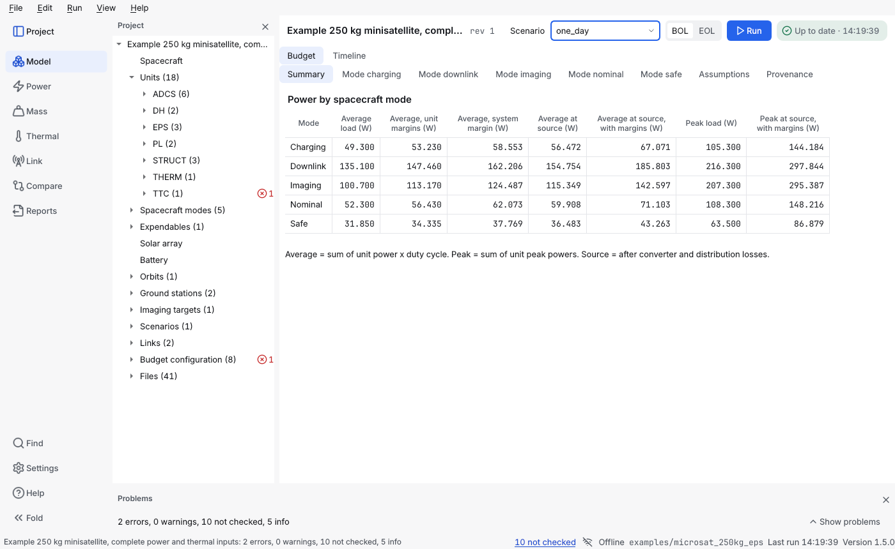
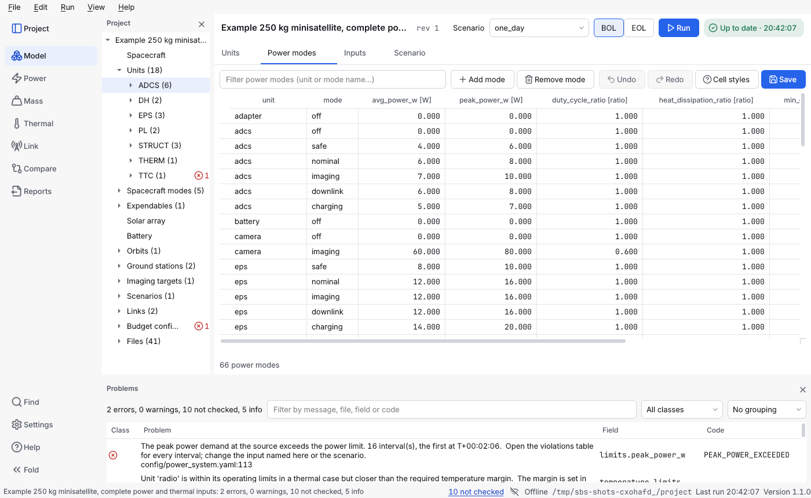

# Use the window

This page is a tour of the graphical window and a list of its shortcuts. Everything the window does can also be done with the [command line](command-line.md).

**Contents:** [Start it](#how-do-i-start-the-window) · [Layout](#what-is-where) · [Run](#how-do-i-run-the-scenario-the-timeline-and-the-passes) · [Errors](#what-happens-when-the-project-has-an-error) · [Problems](#the-problems-panel) · [Shortcuts](#shortcuts) · [Saved layout](#where-does-the-window-keep-its-layout) · [Plots](#how-do-i-use-a-plot) · [Editing](#how-do-i-edit-a-file)

## How do I start the window?

```bash
system-budget-studio                       # then File → Open project
system-budget-studio path/to/project       # open a project at start
```


The picture shows the **full view**. A new window starts in the **focused view** (one line for the problems, no Inspector or Provenance panel, the main columns of the grids); **View → Focused view** (Ctrl+Shift+F) switches between the two, as [described below](#what-is-where).



## What is where?

- **Top bar**: the project name and revision, a marker when something is unsaved, the **scenario** every tab shows, the **BOL / EOL** switch (beginning or end of life, for the power timeline), the **Run** button and the **run status** (not run, running, up to date, out of date, failed).
- **Project tree** (left): the spacecraft model, not the folder listing. It lists the **Spacecraft** file, the **Units** (one row each, by name; with many units they are grouped by subsystem, and the groups start folded), the spacecraft modes, expendables, the solar array and the battery, then the orbits, ground stations, imaging targets, scenarios and links, **Budget configuration**, and **Files**, the plain list of every project file. The id of a unit or link is in its tooltip and in the Inspector. A row with a number next to an icon has an **error** or a **warning** on it (see [the Problems panel](#the-problems-panel)); a folded group shows those of the rows inside it, so that nothing is hidden, and an open one shows only its own. Placeholders (*not checked*) are not counted in the tree: the status bar and the Problems panel count them. **Enter** or a double-click opens a row: a unit opens the table of its power modes (the right-click menu has *Open the file*), a field (the solar array, the battery) opens its file at the line of the field, and any other row opens its file as text. What you fold or open stays that way when the project reloads.
- **Navigation rail** (far left): the seven areas, each with an icon and a name: **Model** (the **Units**, **Power modes**, **Spacecraft modes** and **Inputs** grids, the scenario, the **Assumptions** list, and every file you open), **Power** (*Budget* tables and the *Timeline*), **Mass**, **Thermal**, **Link** (*Budget* and *Passes*), **Compare** and **Reports** (the exports). Click one, or press **Ctrl+1** to **Ctrl+7**. The pages of an area (for example *Budget* and *Timeline*) are a small segmented control at the top of the area. Opening a file never adds an area; the files open inside **Model**. At the bottom of the rail: **Find** (Ctrl+K), **Settings** (theme, UI size, reduce motion), **Help** (F1) and **Fold**, which shows only the icons. The top button shows or hides the project panel (**Ctrl+B**).
- **Right panel** (full view; hidden in the focused view): **Inspector** (what is known about the selected tree row or grid cell: its file and field, and its problems; for a number in the Units or Power modes grid also where it came from, with a field to [record the source](placeholders-and-sources.md#how-do-i-record-where-a-plain-input-came-from)) and **Provenance** (the rows that every report and export carries: tool, versions, project, revision, time, user). It needs room: below 1520 px of window width it is hidden until the window grows (or open it from the **View** menu). Below 1280 px the rail shows icons only; below 1100 px the project panel waits too. A panel you closed yourself stays closed.
- **Focused view** (the default; **View → Focused view**, Ctrl+Shift+F): the window shows what you work with and keeps the rest one click away. The Problems panel is one line with the counts (errors, warnings, not checked, info) and a **Show problems** button; the Inspector and Provenance panels are hidden; and the grids show their main columns, with an **Optional columns** button for the ones a row may leave empty (the temperature limits of a unit, the heat dissipation and minimum duration of a power mode). Turn the focused view off to see everything at once. Nothing in the files, the checks or the results depends on the view, and the *not checked* link in the status bar, **F8** and **Show the first error** open the list of problems for you.
- **First screen.** A project that has units opens on **Power** (its budgets). A project with no unit yet opens on **Model**, on the Units grid, where the first step is. The rail on the left always names the area on show.
- **Start here** (a card under the top bar, while a project has a step left to do): four steps that take a new project to its first result, as small buttons with a tick or a dashed circle (*Unit*, *Spacecraft mode*, *Orbit and scenario*, *Save and run*). The second line says what the step to do now means and has its blue button, which does what the menu entry does: **Add unit…** (Ctrl+Shift+N), **Add mode…** (Ctrl+Shift+M), **Add scenario…** (Ctrl+Shift+O) or **Save and run** (saves, then runs once the project has loaded again). A step that needs an earlier one waits, and its tooltip says which. A step is ticked when the files on screen say so (an edit counts, an undo takes the tick back). The card goes when all four are done, and the window shows the power timeline, the first result, with a note where Mass, Thermal and Link are. The **×** hides it for good (the window remembers) and **Help → Start here** (or Ctrl+K) shows it again.
- **Problems panel** (bottom, the full width): every finding with its class, message, field and code; see [the Problems panel](#the-problems-panel). In the focused view it is one line with the counts and a **Show problems** button. In the full view you can drag its top edge to make it taller; close it with its × and **View → Problems** brings it back.
- **Status bar**: **N not checked** (a link that lists the placeholders in the Problems panel), *Offline* (the program makes no network connections), the project folder, when something was last worked out, and the program version.

## How do I run the scenario, the timeline and the passes?

The static budgets (power, mass, thermal, link) are worked out whenever the project loads, so their tables are always up to date. **Run** (**Ctrl+R**) works out, for the selected scenario, the scenario (eclipses, passes, mode timeline), the power timeline and the link passes, in that order, in a background thread: the window stays usable. The buttons **Compute** in *Model → Scenario*, *Power → Timeline* and *Link → Passes* do the same for one view. A result is the same either way.
On *Power → Timeline* and *Link → Passes* the table under the plots can be folded away with the **Table** button (press it again to bring the table back) when you want the plots to have all the room; the two arrows after *Violation* step through the intervals that break a limit. When some inputs are placeholders, a banner at the top of the budget pages says so once: entries marked *n/a* depend on them and are not computed.


The chip next to **Run** says where the results stand, with an icon and a word: **Not run**, **Running…**, **Up to date** (and the time), **Out of date** or **Run failed**. A run reads the **saved** files: while edits in the grids or the scenario are not saved the chip says **Out of date** (its tooltip says why), and pressing **Run** then says in the status bar that the run is on the saved files. Save (Ctrl+S) and press **Run** to work out what is on screen. A failed run also shows a banner under the top bar with the reason and **Run again**.

Every result remembers what it was computed from. If the project changes (a saved edit, F5, an import), or you switch the scenario or the **Demand** basis, or in **Compare** change the other folder or a scenario, the old result is marked **out of date**: the view says so, **Export** is switched off, and its findings leave the Problems panel until you run again. The same holds for the scenario when an orbit, ground station or target file changed. A result for a scenario you have since deselected is not shown.

Closing the window while a computation or an export is running does not interrupt it: the window closes by itself when the job has finished.

## What happens when the project has an error?

The tables do not go blank. They keep showing the **last results that worked**, and a yellow banner under the top bar says so: *the tables show the last results that worked, from before the error, and may not match the files*. **Show the first error** opens the file at the line. Nothing from those old results can be exported, and the time-domain views (scenario, timeline, passes, compare) are empty until the project loads again, with a sentence that says why. Fix the error and save: the banner goes and the tables update.

## The Problems panel

Every finding of the project, in one list, errors first. Each row has an **icon** for its class and, under the message, the file and line:

| Class | Icon | Meaning |
|---|---|---|
| **Error** | circle with a cross | The project cannot be used as it is, or a limit is broken |
| **Warning** | triangle | Results are produced, but something needs a look |
| **Not checked** | circle with a bar | A result could not be worked out because an input is a placeholder or missing (`n/a`). Neither a pass nor a fail |
| **Info** | circle with an i | Nothing to fix |

In the focused view only the summary line is shown, with a **Show problems** button; the list opens by itself when you follow the *not checked* link of the status bar, press **F8** or use **Show the first error**. *Not checked* is kept apart from warnings so that a project with a hundred placeholders does not hide its few real warnings. The **filter box** matches the message, file, field and code; the **class** selector shows one class; the third selector groups by class or by file. Double-click or **Enter** on a row opens the file at the line; **F8** and **Shift+F8** go to the next and the previous problem. Right-click the header to hide the *Field* and *Code* columns. The summary beside the filter counts the classes, and says how many are shown when a filter is on.

## Shortcuts

| Shortcut | Action |
|---|---|
| Ctrl+N | New project (guided wizard) |
| Ctrl+O | Open project (or drop a project folder on the window) |
| Ctrl+K | Find a command: a card over the window. Type a few words to run a menu command (its menu, its name and its key are shown apart) or go to a unit, a file, a scenario or a problem; Up and Down choose, Enter runs, Esc closes |
| Ctrl+B | Show or hide the project panel |
| Ctrl+Shift+A | Show the **Assumptions** list: everything that is active for the project ([placeholders and sources](placeholders-and-sources.md#where-do-i-see-everything-that-is-active), [trace a number](trace-a-number.md)) |
| Ctrl+S | Save what you are editing (a text tab, the grids of *Units*, *Power modes* and *Inputs*, or the scenario); it acts only while the **Model** area is in front |
| Ctrl+Z / Ctrl+Y (or Ctrl+Shift+Z) | Undo / redo an edit of the grids or the scenario (the Edit menu names the step); a text editor keeps its own undo while it has the keyboard |
| Ctrl+C / Ctrl+V | In a grid: copy the selected cells as text with tabs; paste a block (from this or any spreadsheet) |
| Ctrl+D / Delete | In a grid: fill the selection down from its top cell / empty the optional cells of the selection |
| F5 | Reload the project from disk (the window stays usable while it loads; the status bar says so) |
| Ctrl+R | Run: the scenario, the power timeline and the link passes |
| Ctrl+1 … Ctrl+7 | Go to the area Model, Power, Mass, Thermal, Link, Compare, Reports |
| Enter | Open the selected row of the project tree or of the Problems panel |
| F8 / Shift+F8 | Next / previous problem (opens its file at the line) |
| Ctrl+M | Show the selected unit's power modes in the **Power modes** grid |
| Ctrl+E | Export reports of the static budgets |
| Ctrl+Shift+E | Export the power timeline |
| Ctrl+Shift+N / Ctrl+Shift+Delete | **Edit → Add unit** / **Remove unit**, from any area: they bring *Model → Units* to the front ([add a unit](describe-the-spacecraft.md#how-do-i-add-a-unit)). Remove takes the unit with the cursor in the grid, or the unit selected in the project tree |
| Ctrl+Shift+M / Ctrl+Shift+Backspace | **Edit → Add spacecraft mode** / **Remove spacecraft mode**, from any area: they bring *Model → Spacecraft modes* to the front ([add a spacecraft mode](describe-the-spacecraft.md#how-do-i-add-a-spacecraft-mode)) |
| Ctrl+Shift+F | **View → Focused view** on or off: one line of problem counts, no Inspector or Provenance panel, only the main columns; off shows everything |
| Ctrl+Shift+I | **View → Explain this value**, or right-click a value in a Power, Mass, Thermal or Link table (also the power timeline and the link passes): opens the **Explain** panel with the equation, the inputs (value, unit, file and path they were read from, source) and the steps that give the value ([explain](../models/explain.md)). The panel is hidden until you ask |
| Ctrl+Shift+O | **Edit → Add scenario**, from any area: an orbit and a scenario from a form; it brings *Model → Scenario* to the front ([add an orbit and a scenario](scenarios.md#how-do-i-add-an-orbit-and-a-scenario-in-the-window)) |
| Ctrl+Shift+G / Ctrl+Shift+T | **Edit → Add ground station** / **Add imaging target**, from any area: a name, an id, latitude, longitude, altitude and minimum elevation from a form ([how](scenarios.md#how-do-i-add-a-ground-station-or-an-imaging-target)) |
| Ctrl+Shift+L | **Edit → Add link**, from any area: the structure of an RF link from a form, with its sourced numbers as placeholders ([how](link-budget.md#how-do-i-describe-a-link)) |
| Ctrl+Shift+B | **Edit → Add Eb/N0 entry**, from any area: a modulation and coding pair of the Eb/N0 table that a link can name, with the Eb/N0 it requires as a placeholder ([how](link-budget.md#how-do-i-describe-a-link)) |
| Ctrl+Shift+R | **Edit → Remove from project**, from any area: an expendable, a ground station, an imaging target or a link, chosen in a small form; refused while a scenario or a link names it |
| Ctrl+Shift+X | **Edit → Add expendable**, from any area: propellant, an oxidizer, a pressurant or the like from a form, with a mass for every mission phase ([how](mass-budget.md#how-do-i-handle-mission-phases-and-propellant)) |
| (menu only) | File → Export unit table / Import unit table: the unit power modes as a CSV or XLSX table, imported with a preview ([unit tables](unit-tables.md)) |
| (menu only) | File → Export scenario results: writes the eclipses, passes and mode timeline of the computed scenario |
| (menu only) | View → Theme (light, dark, same as the system), UI size (90, 100, 110 or 125 %), Reduce motion, Cell styles (what every cell style means), the panel toggles, Reset layout |
| (menu only) | Help → Start here: shows the *Start here* card again after you hid it (it is also in Ctrl+K, with every other menu entry) |
| F1 | Open the user guide |

With no project open the window shows a welcome page: **Open a project folder…**, **New project (guided)…**, or drop a project folder on the window. There is no list of recent projects, because the tool does not keep the paths of your projects. In the **Model** grids the **Inspector** (right panel) shows the cell that has the cursor: its row, column and unit, the file and field, the value, its state, what the column means and, when the value is refused, why.

While a run is in progress, **Run** becomes **Cancel** (Ctrl+R is the same button), a thin bar runs under the top bar and the status chip names the step (*Orbit, eclipses and passes*, *Power timeline: battery*, *Link passes*). **Cancel** keeps the results you had on screen and stops the steps that were still to come; it takes effect when the step in progress ends, which can be a few seconds for a week at 1 s. The *Compute* button of the Scenario, Timeline and Passes views is a Cancel button in the same way while it works.

**Tab** moves through the controls of the window and **Shift+Tab** back; it does not stay inside a read-only table. In a grid it moves from cell to cell and leaves the grid after the last one.

## Where does the window keep its layout?

The window remembers its size and position, which panels are where, whether the rail is folded, whether you hid the *Start here* card, whether the focused view is on, how wide the Problems columns are, and the theme, the UI size, *Reduce motion* and *Open with a single click*, in one small file of its own, `layout.ini`, in your configuration folder (on Linux `~/.config/System Budget Studio/`, on Windows `%APPDATA%\System Budget Studio\`). It contains no project name, path or value. **View → Reset layout** deletes what it remembered and restores the first layout; deleting the file does the same. See [the design page](../DESIGN.md#the-layout-file).

## How do I use a plot?

Hover to move a cursor with a readout of every series at that time. The mouse wheel zooms around the pointer, dragging pans, double-click shows everything. **A click pins a second cursor**: the readout then shows the differences between the two times. Escape or a right click removes it. The check box **Shade eclipses and passes** turns the shaded bands on and off.

## How do I edit a file?

Press Enter (or double-click, or click once with *Open with a single click* on) on it in the tree. It opens as text in a tab of the **Model** area; **Ctrl+S** saves, and the project is checked again (the same checks as `budget validate`). Closing a modified tab, opening another project or quitting asks first, so you cannot lose edits by accident. A file that is not valid UTF-8 is refused instead of being damaged. A byte-order mark and Windows line ends in the file are kept. If the file changed on disk after you opened it (another program, a git checkout), saving asks before it overwrites that change; an editor without edits shows the new file by itself.

In **Model → Scenario**, rules and segments are sentences you edit in place ([scenarios](scenarios.md#how-do-i-edit-the-rules-in-the-window)); the grids and the scenario share one undo (Ctrl+Z) and one **Save** button and Ctrl+S ([below](#how-do-i-edit-in-the-grids)), and Save writes every changed file at once. Saving and undo change only what you edited: comments, the order of the keys and fields the grid does not show stay in the file, and saving without a change leaves the file untouched. Only if a file is in an older layout that cannot be patched is it rewritten whole, and if it has comments you are asked first (the comments are not kept in that case; answer No to keep the file as it is).

## How do I make the window easier to read or to use with the keyboard?

- **UI size.** *View > UI size* (or *Settings* in the rail) is 90, 100, 110 or 125 %: text, buttons and tables grow and shrink together. The window is laid out completely at the size you start with; a size changed while the window is open reaches the text and most controls at once and a few fixed sizes at the next start. At 125 % the smallest window is 1093 x 793, so use 110 % or less on a 1366 x 768 screen.
- **Theme.** *View > Theme*: light, dark, or the system's, which switches live.
- **Reduce motion.** *View > Reduce motion* (or in *Settings*) turns off every transition.
- **Open with a single click.** *View > Open with a single click* (or in *Settings*, *Open and edit with a single click*) is for people who do not want to double-click: a click on a node of the project tree opens it, and a click on a cell that is already selected starts editing it. Enter, F2 and typing work as before. It is off at first and the window remembers the choice.
- **Keyboard.** Tab visits every control and Shift+Tab goes back; the control that has the keyboard shows a 2 px ring. Every frequent action has a shortcut that its tooltip and its menu entry show (the [shortcuts above](#shortcuts)), and **Ctrl+K** finds any command by its name.
- **Screen readers.** Every button that shows only an icon, every grid, table and plot, and every input has a name (for example *Units grid*, *Power timeline plot*, *Folder to write the files into*).

## How do I edit in the grids?

**Model → Units** has one row per unit: name, subsystem, bus, maturity, mass and the four temperature limits (the limits are *optional columns*, hidden in the focused view; the **Optional columns** button above the grid shows them); **Add unit** and **Remove unit** (also in the right-click menu, in the Edit menu and in Ctrl+K) add and remove units ([how](describe-the-spacecraft.md#how-do-i-add-a-unit)). **Power modes** has one row per power mode of every unit: average and peak power, duty cycle, heat ratio and durations, with the effective average (average times duty) beside them. **Inputs** has one row per sourced number of the configuration and the links: value, unit, source and note. The unit is in every column header; numbers show a fixed number of decimals, and the tooltip and the editor have the exact value.



- **Type or paste.** Double-click a cell, press F2 or start typing. A value with a unit is converted (`2500 mW` is 2.5 W). **Enter** accepts and moves down, **Esc** cancels, **Tab** accepts and moves right. Copy a range from a spreadsheet and press **Ctrl+V**: the block goes in from the current cell (one value goes into every selected cell). More than one cell shows you a preview, old and new, first. Cells that cannot be edited (the unit id, the computed average) are left out and counted.
- **Fill down and clear.** Select a cell and the cells below it and press **Ctrl+D**. **Delete** empties the cells that may be empty (an optional field); a field the model needs keeps its value.
- **A wrong value is kept and explained.** The cell gets a red marker, its tooltip and the line under the grid say what is wrong, in words and with the field only, never the text you typed. Nothing is written while a cell is wrong: **Save** says so, and you can correct the cell or undo.
- **Undo.** Every edit, paste, fill and added or removed unit or mode is one step of **Edit → Undo** (Ctrl+Z); **Redo** is Ctrl+Y (Ctrl+Shift+Z works too). The step is named ("Edit radio / downlink: avg_power_w"). Undo works across a save.
- **Save.** **Save** (the button or Ctrl+S) writes only the files that changed, in place: comments, key order and the fields the grids do not show stay as they were. A file you added (a unit, a spacecraft mode, a scenario with its orbit, an expendable, a ground station, an imaging target or a link) is created, and the file of a unit, a spacecraft mode, an expendable, a ground station, an imaging target or a link you removed is deleted, after a question. If a file cannot be changed in place and has comments, it asks before writing the file whole without them. It refuses to overwrite a file that changed on disk after the grid loaded it, and says which. Closing, opening another project or quitting asks first when edits are not saved.
- **Spacecraft modes.** *Model → Spacecraft modes* has one row per unit in every spacecraft mode and one editable cell: the power mode the unit is in. The cell is a **drop-down of that unit's power modes** (double-click, F2 or just start typing opens it), so a name that does not exist cannot be chosen; a name pasted from a spreadsheet that the unit has no power mode of is refused (with the list of its power modes) and nothing is written. **Add mode** and **Remove mode** add and remove a whole spacecraft mode ([how](describe-the-spacecraft.md#how-do-i-add-a-spacecraft-mode)).
- **Add or remove a power mode.** *Power modes → Add mode* adds a mode to the unit of the current row; *Remove mode* removes the current one (a unit keeps at least one). Both can be undone. Removing a mode that a spacecraft mode uses is allowed, and the Problems panel then names the spacecraft mode.
- **The toolbar.** Above every grid: the **filter** (it keeps the rows that contain the text in any column; a paste goes to the rows shown), the tools of the page (*Add mode*, *Remove mode*, and in *Inputs* **Placeholders only**), **Optional columns** (on the grids that have columns a row may leave empty: shown in the full view, hidden in the focused view; the files and the checks do not depend on it), **Undo**, **Redo**, **Cell styles** and **Save**, the blue button. The first column (the unit, power mode or input) stays in view when you scroll the grid sideways, and a row with a wrong cell is marked in that column even when the cell itself is out of view.
- **Cell styles.** The **Cell styles** button opens the legend. A *not checked* cell with `n/a` in the units grid means no temperature limit (or no heat ratio) is given, so the unit is not checked against it. In *Inputs* a **placeholder** (no value, or the source `TBD`) is italic with a dashed border and a hollow marker: type its value and its source, and the style goes when both are there. **Right-click → Mark as sourced…** takes the cursor to what is missing.

A unit in the project tree opens its power modes in this grid (Enter, double-click, or **Ctrl+M**).

The file dialogs do not remember the last folder you used: the only file the window keeps outside your project folders is `layout.ini` ([above](#where-does-the-window-keep-its-layout)).

Next: [Command-line reference](command-line.md) · [Tips](../tips.md).
