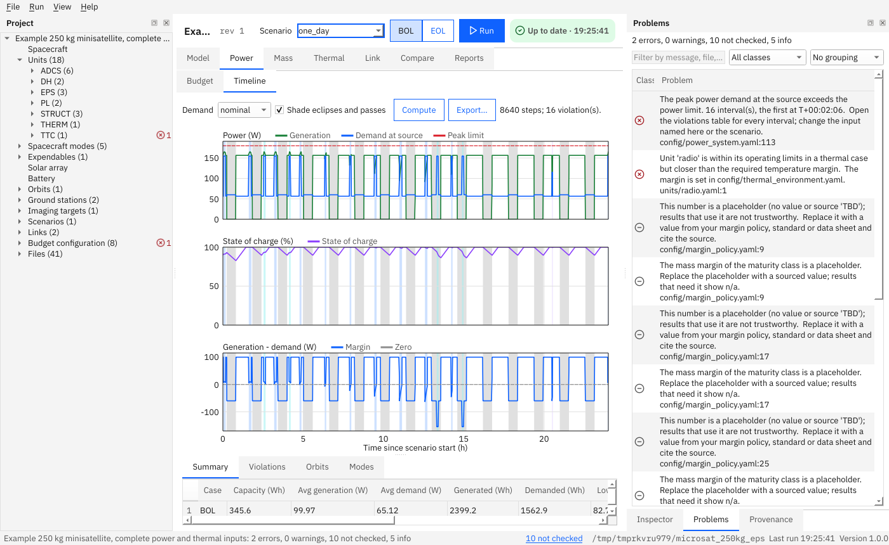

# Use the window

This page is a tour of the graphical window and a list of its shortcuts. Everything the window does can also be done with the [command line](command-line.md).

**Contents:** [Start it](#how-do-i-start-the-window) · [Layout](#what-is-where) · [Shortcuts](#shortcuts) · [Plots](#how-do-i-use-a-plot) · [Editing](#how-do-i-edit-a-file)

## How do I start the window?

```bash
system-budget-studio                       # then File → Open project
system-budget-studio path/to/project       # open a project at start
```



## What is where?

- **Project tree** (left): spacecraft, units, spacecraft modes, orbits, ground stations, imaging targets, scenarios, links and configuration files. Double-click a file to edit it as text; double-click a unit to edit its power modes in a table.
- **Tabs** (centre): **Power budget**, **Mass budget**, **Thermal budget**, **Link budget** (static tables, updated whenever the project changes), **Scenario**, **Power timeline**, **Link passes** (press **Compute**; they run in a background thread so the window stays responsive), and **Compare**.
- **Problems panel** (bottom): errors, warnings and open items. Double-click a row to jump to the file and line. The counts are also in the status bar.

Every result remembers what it was computed from. If the project changes (a saved edit, F5, an import), or you switch the scenario or the **Demand** basis, or in **Compare** change the other folder or a scenario, the old result is marked **stale**: the tab says so, **Export** is switched off, and its findings leave the Problems panel until you press **Compute** (or **Compare**) again. The same holds for the **Scenario** tab when an orbit, ground station or target file changed. A result for a scenario you have since deselected is not shown.

Closing the window while a computation or an export is running does not interrupt it: the window closes by itself when the job has finished.

## Shortcuts

| Shortcut | Action |
|---|---|
| Ctrl+N | New project (guided wizard) |
| Ctrl+O | Open project |
| Ctrl+S | Save the file you are editing (the text tab, the unit table or, in the Scenario tab, the scenario) |
| F5 | Reload the project from disk |
| Ctrl+M | Edit the selected unit's power modes in a table |
| Ctrl+E | Export reports of the static budgets |
| Ctrl+Shift+E | Export the power timeline |
| (menu only) | File → Export unit table / Import unit table: the unit power modes as a CSV or XLSX table, imported with a preview ([unit tables](unit-tables.md)) |
| (menu only) | File → Export scenario results: writes the eclipses, passes and mode timeline of the computed scenario |
| F1 | Open the user guide |

(On macOS the Ctrl key shortcuts are not tested.)

## How do I use a plot?

Hover to move a cursor with a readout of every series at that time. The mouse wheel zooms around the pointer, dragging pans, double-click shows everything. **A click pins a second cursor**: the readout then shows the differences between the two times. Escape or a right click removes it. The check box **Shade eclipses and passes** turns the shaded bands on and off.

## How do I edit a file?

Double-click it in the tree. It opens as text in a tab; **Ctrl+S** saves, and the project is checked again (the same checks as `budget validate`). Closing a modified tab, opening another project or quitting asks first, so you cannot lose edits by accident. A file that is not valid UTF-8 is refused instead of being damaged. A byte-order mark and Windows line ends in the file are kept. If the file changed on disk after you opened it (another program, a git checkout), saving asks before it overwrites that change; an editor without edits shows the new file by itself.

In the **Scenario** tab, use the rule and segment buttons and **Save scenario**; the unit table has its own **Save**. Both change only what you edited: comments, the order of the keys and fields the table does not show (for example the heat dissipation ratio of a power mode) stay in the file, and saving without a change leaves the file untouched. Only if a file is in an older layout that cannot be patched is it rewritten whole, and the editor then says that comments were not kept.

The file dialogs do not remember the last folder you used: the program keeps no settings outside your project folders.

Next: [Command-line reference](command-line.md) · [Tips](../tips.md).
