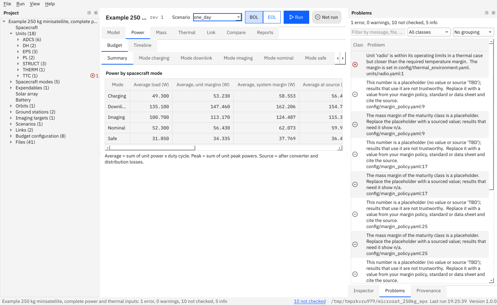

# Use the window

This page is a tour of the graphical window and a list of its shortcuts. Everything the window does can also be done with the [command line](command-line.md).

**Contents:** [Start it](#how-do-i-start-the-window) · [Layout](#what-is-where) · [Run](#how-do-i-run-the-scenario-the-timeline-and-the-passes) · [Errors](#what-happens-when-the-project-has-an-error) · [Problems](#the-problems-panel) · [Shortcuts](#shortcuts) · [Saved layout](#where-does-the-window-keep-its-layout) · [Plots](#how-do-i-use-a-plot) · [Editing](#how-do-i-edit-a-file)

## How do I start the window?

```bash
system-budget-studio                       # then File → Open project
system-budget-studio path/to/project       # open a project at start
```



## What is where?

- **Top bar**: the project name and revision, a marker when something is unsaved, the **scenario** every tab shows, the **BOL / EOL** switch (beginning or end of life, for the power timeline), the **Run** button and the **run status** (not run, running, up to date, out of date, failed).
- **Project tree** (left): the spacecraft model, not the folder listing. It lists the **Spacecraft** file, the **Units** (one row each, by name; with many units they are grouped by subsystem, and the groups start folded), the spacecraft modes, expendables, the solar array and the battery, then the orbits, ground stations, imaging targets, scenarios and links, **Budget configuration**, and **Files**, the plain list of every project file. The id of a unit or link is in its tooltip and in the Inspector. A row with a number next to an icon has an **error** or a **warning** on it (see [the Problems panel](#the-problems-panel)); a folded group shows those of the rows inside it, so that nothing is hidden, and an open one shows only its own. Placeholders (*not checked*) are not counted in the tree: the status bar and the Problems panel count them. **Enter** or a double-click opens a row: a unit opens the table of its power modes (the right-click menu has *Open the file*), a field (the solar array, the battery) opens its file at the line of the field, and any other row opens its file as text. What you fold or open stays that way when the project reloads.
- **Tabs** (centre): **Model** (the scenario, and every file or unit table you open), **Power** (*Budget* tables and the *Timeline*), **Mass**, **Thermal**, **Link** (*Budget* and *Passes*), **Compare** and **Reports** (the exports). **Ctrl+1** to **Ctrl+7** go to a tab. Opening a file never adds a tab to the budgets; the files open inside **Model**.
- **Right panel**: **Inspector** (what is known about the selected tree row: its file and field, and its problems), **Problems** and **Provenance** (the rows that every report and export carries: tool, versions, project, revision, time, user). Drag a tab out of the panel to move it; **View → Reset layout** puts everything back.
- **Status bar**: the project folder, when something was last worked out, the program version, and **N not checked**, a link that lists the placeholders in the Problems panel.

## How do I run the scenario, the timeline and the passes?

The static budgets (power, mass, thermal, link) are worked out whenever the project loads, so their tables are always up to date. **Run** (**Ctrl+R**) works out, for the selected scenario, the scenario (eclipses, passes, mode timeline), the power timeline and the link passes, in that order, in a background thread: the window stays usable. The buttons **Compute** in *Model → Scenario*, *Power → Timeline* and *Link → Passes* do the same for one view. A result is the same either way.

The chip next to **Run** says where the results stand, with an icon and a word: **Not run**, **Running…**, **Up to date** (and the time), **Out of date** or **Run failed**. A failed run also shows a banner under the top bar with the reason and **Run again**.

Every result remembers what it was computed from. If the project changes (a saved edit, F5, an import), or you switch the scenario or the **Demand** basis, or in **Compare** change the other folder or a scenario, the old result is marked **out of date**: the view says so, **Export** is switched off, and its findings leave the Problems panel until you run again. The same holds for the scenario when an orbit, ground station or target file changed. A result for a scenario you have since deselected is not shown.

Closing the window while a computation or an export is running does not interrupt it: the window closes by itself when the job has finished.

## What happens when the project has an error?

The tables do not go blank. They keep showing the **last results that worked**, and a yellow banner under the top bar says so: *the tables show the last results that worked, from before the error, and may not match the files*. **Show the first error** opens the file at the line. Nothing from those old results can be exported, and the time-domain views (scenario, timeline, passes, compare) are empty until the project loads again, with a sentence that says why. Fix the error and save: the banner goes and the tables update.

## The Problems panel

Every finding of the project, in one list, errors first. Each row has an **icon** for its class and, under the message, the file and line:

| Class | Icon | Meaning |
|---|---|---|
| **Error** | circle with a cross | The project cannot be used as it is, or a limit is broken |
| **Warning** | triangle | Results are produced, but something needs a look |
| **Not checked** | circle with a bar | A result could not be worked out because an input is a placeholder or missing (`n/a`). Neither a pass nor a fail |
| **Info** | circle with an i | Nothing to fix |

*Not checked* is kept apart from warnings so that a project with a hundred placeholders does not hide its few real warnings. The **filter box** matches the message, file, field and code; the **class** selector shows one class; the third selector groups by class or by file. Double-click or **Enter** on a row opens the file at the line; **F8** and **Shift+F8** go to the next and the previous problem. Right-click the header to show the *Field* and *Code* columns. The summary above the list counts the classes, and says how many are shown when a filter is on.

## Shortcuts

| Shortcut | Action |
|---|---|
| Ctrl+N | New project (guided wizard) |
| Ctrl+O | Open project |
| Ctrl+S | Save the file you are editing (the text tab, the unit table or, in *Model → Scenario*, the scenario); it acts only while the **Model** tab is in front |
| F5 | Reload the project from disk (the window stays usable while it loads; the status bar says so) |
| Ctrl+R | Run: the scenario, the power timeline and the link passes |
| Ctrl+1 … Ctrl+7 | Go to the tab Model, Power, Mass, Thermal, Link, Compare, Reports |
| Enter | Open the selected row of the project tree or of the Problems panel |
| F8 / Shift+F8 | Next / previous problem (opens its file at the line) |
| Ctrl+M | Edit the selected unit's power modes in a table |
| Ctrl+E | Export reports of the static budgets |
| Ctrl+Shift+E | Export the power timeline |
| (menu only) | File → Export unit table / Import unit table: the unit power modes as a CSV or XLSX table, imported with a preview ([unit tables](unit-tables.md)) |
| (menu only) | File → Export scenario results: writes the eclipses, passes and mode timeline of the computed scenario |
| (menu only) | View → Theme (light, dark, same as the system), Cell styles (what every cell style means), the panel toggles, Reset layout |
| F1 | Open the user guide |

**Tab** moves through the controls of the window and **Shift+Tab** back; it does not stay inside a table. (On macOS the Ctrl key shortcuts are not tested.)

## Where does the window keep its layout?

The window remembers its size and position, which panels are where and how wide the Problems columns are, and the theme, in one small file of its own, `layout.ini`, in your configuration folder (on Linux `~/.config/System Budget Studio/`, on Windows `%APPDATA%\System Budget Studio\`). It contains no project name, path or value. **View → Reset layout** deletes what it remembered and restores the first layout; deleting the file does the same. See [the design page](../DESIGN.md#the-layout-file).

## How do I use a plot?

Hover to move a cursor with a readout of every series at that time. The mouse wheel zooms around the pointer, dragging pans, double-click shows everything. **A click pins a second cursor**: the readout then shows the differences between the two times. Escape or a right click removes it. The check box **Shade eclipses and passes** turns the shaded bands on and off.

## How do I edit a file?

Press Enter (or double-click) on it in the tree. It opens as text in a tab of the **Model** tab; **Ctrl+S** saves, and the project is checked again (the same checks as `budget validate`). Closing a modified tab, opening another project or quitting asks first, so you cannot lose edits by accident. A file that is not valid UTF-8 is refused instead of being damaged. A byte-order mark and Windows line ends in the file are kept. If the file changed on disk after you opened it (another program, a git checkout), saving asks before it overwrites that change; an editor without edits shows the new file by itself.

In **Model → Scenario**, use the rule and segment buttons and **Save scenario**; the unit table has its own **Save**. Both change only what you edited: comments, the order of the keys and fields the table does not show (for example the heat dissipation ratio of a power mode) stay in the file, and saving without a change leaves the file untouched. Only if a file is in an older layout that cannot be patched is it rewritten whole, and the editor then says that comments were not kept.

The file dialogs do not remember the last folder you used: the program keeps no settings outside your project folders.

Next: [Command-line reference](command-line.md) · [Tips](../tips.md).
